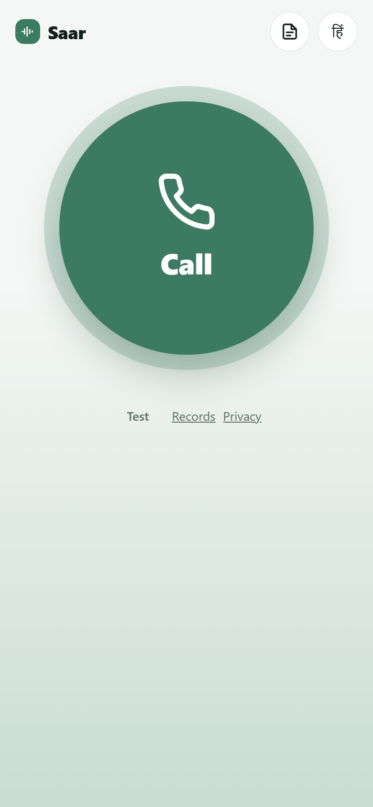
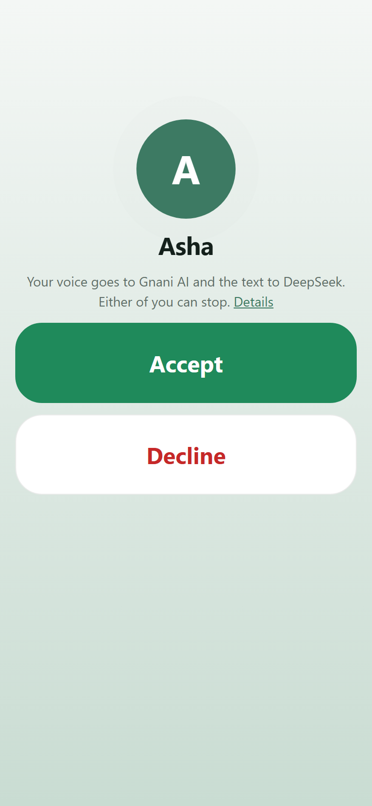
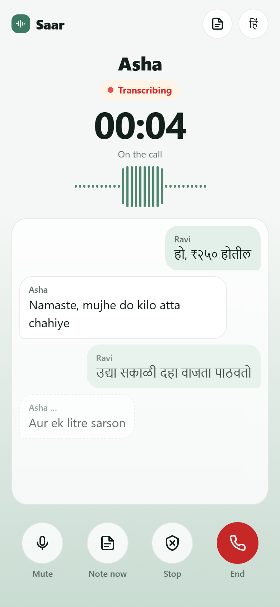
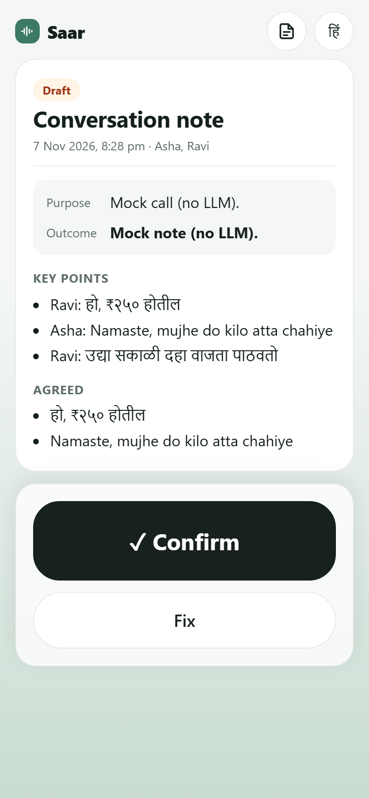
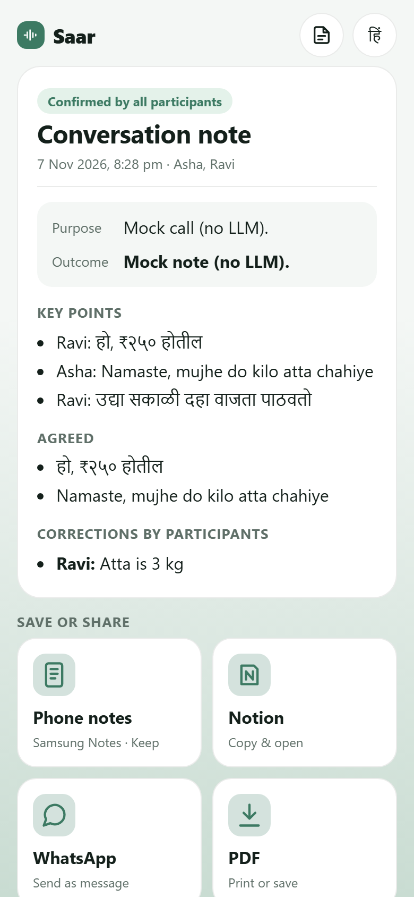

# Saar · सार

**One platform for every distributor call.** Saar is a consent-first calling app for India's kirana stores. When both people agree, it transcribes the call live with **Gnani Prisma**, turns it into a structured order record, and keeps a running ledger for every distributor. Hindi, Marathi and English work in the same call.

| Call by number | It rings on their phone | Live captions | Both confirm | Final record |
|---|---|---|---|---|
|  |  |  |  |  |

_Screenshots come from the automated two-phone test (fake microphone, fake speech service, mock summariser)._

- **Product demo (2:45):** [media/videos/saar-demo.mp4](media/videos/saar-demo.mp4), a real recorded call with live Prisma transcription and a technical walkthrough.
- **Promo film (60 s):** [media/videos/saar-promo.mp4](media/videos/saar-promo.mp4)
- **One-page summary:** [SOLUTION_PITCH.md](SOLUTION_PITCH.md)

---

## Contents
1. [The problem](#the-problem)
2. [Features](#features)
3. [How it works](#how-it-works)
4. [Gnani models and APIs](#gnani-models-and-apis)
5. [Repository structure](#repository-structure)
6. [Getting started](#getting-started)
7. [Configuration](#configuration)
8. [Testing](#testing)
9. [Evaluation](#evaluation)
10. [Demo and promo videos](#demo-and-promo-videos)
11. [Privacy and consent](#privacy-and-consent)
12. [Limitations and roadmap](#limitations-and-roadmap)
13. [Team](#team)

---

## The problem
A kirana store restocks through phone calls with a dozen or more distributors. Quantities, rates and delivery dates are agreed by voice and written into separate diaries, if at all. When the bill arrives and the numbers do not match, there is no record of what was actually said.

## Features
- **Call by mobile number.** If Saar is open on the other phone it rings there; otherwise a one-tap WhatsApp or SMS invite link is sent.
- **Consent first.** Nothing is transcribed until both people accept the consent notice. Either person can stop at any time, for both.
- **Live, multilingual captions.** Each phone streams only its own microphone. Prisma identifies the language of every segment, so a call can move between Hindi, English and Marathi.
- **Structured order record.** When the call ends, an LLM writes the record (items, quantities, rates, totals, delivery, to-dos) into a strict JSON schema. Totals are computed in code, and every number is checked against the transcript.
- **Two-sided confirmation.** Both people confirm the record, or send a correction that rewrites it, before it becomes final.
- **Distributor records.** Every person you call gets a running record built from confirmed calls: call count, total value, items, rate changes (▲▼) and open tasks.
- **Excel export.** One sheet for a single distributor or for everyone, as a CSV with a UTF-8 BOM so Excel shows ₹ and Indic text correctly.
- **WhatsApp drafts.** A ready-to-send order summary, written in the language that distributor actually spoke on recent calls.
- **Other exports.** Phone notes apps (Samsung Notes, Google Keep) through the share sheet, Notion, Markdown and PDF.
- **Local first.** Records live on each phone in IndexedDB and work offline. Saar never stores audio.

## How it works
```
 Phone A (PWA)                                          Phone B (PWA)
 LiveKit client  ◄───────── WebRTC call audio ─────────► LiveKit client
 Mic → AudioWorklet (16 kHz PCM, 1,024-byte frames)      Mic → AudioWorklet
   │ WS /ws/stt (own mic only)    WS /ws/room (events)     │
   ▼                                                       ▼
 ┌──────────────────── Saar backend (FastAPI, single process) ────────────────────┐
 │ Rooms and consent state machine · STT proxy (pacer, rotation, reconnect)       │
 │ Room hub (reorder buffer, echo dedupe) · Summariser + faithfulness check       │
 │ Call signalling (/ws/inbox) · Retention job · SQLite (text only, 24 h)          │
 └───────────────┬─────────────────────────────────────────────────┬──────────────┘
                 ▼                                                 ▼
      Gnani Prisma v3.0 (streaming WebSocket)              LLM (JSON-schema note)
```

**Live speech path**
1. Each phone captures only its own microphone. An `AudioWorklet` resamples it to 16 kHz mono PCM and emits exact 1,024-byte frames (512 samples, 32 ms).
2. Frames travel over a WebSocket to the FastAPI backend, which paces them in real time to Gnani's streaming endpoint. The Gnani key never reaches the browser.
3. Prisma returns partial hypotheses while someone speaks, and a final segment after voice-activity detection, with a `detected_language_code`.
4. The room hub orders segments from both speakers by time, hides likely loudspeaker echo, and broadcasts them to both phones.

**Record path**
1. When the call ends, the ordered transcript goes to the LLM, constrained by a JSON schema and validated, with one retry.
2. Line totals and grand totals are computed in code, not by the model.
3. A deterministic faithfulness check matches every number and name to the transcript and flags anything unsupported.
4. Both people confirm or correct. The final record is saved on each phone and feeds that distributor's ledger, the Excel sheet and the WhatsApp draft.

**Why each phone transcribes only itself:** perfect speaker separation without diarization, clean audio (not the network-degraded call audio) into speech recognition, and unambiguous consent. More detail: [docs/ARCHITECTURE.md](docs/ARCHITECTURE.md).

## Gnani models and APIs
| Gnani API | Used for | Code |
|---|---|---|
| **Prisma v3.0 streaming STT** (`wss://api.vachana.ai/stt/v3/stream`) | Every live caption. One upstream socket per participant; `indic-auto` language identification with a `detected_language_code` per segment; VAD tuned for conversation; inverse text normalisation; optional word boosting; rotation before the 15-minute session cap | `backend/app/gnani/stt_client.py`, `backend/app/ws/stt_proxy.py` |
| **Prisma STT REST** (`POST /stt/v3`) | Evaluation sweeps, faster than real time | `eval/` |
| **Timbre TTS** (`POST /api/v1/tts/inference`) | Synthetic evaluation dialogues, and the narration of the demo and promo videos. Not used by the app itself | `eval/make_audio.py`, `media/` |

**Other components:** the record is written by **DeepSeek** through an OpenAI-compatible API (transcript text only); the voice call is relayed by **LiveKit** (WebRTC).

**Tech stack:** Python 3.11, FastAPI, SQLModel/SQLite, websockets · React 18, TypeScript, Vite, PWA, IndexedDB · LiveKit · pytest, Vitest, Playwright.

## Repository structure
```
.
├── backend/                 FastAPI service
│   ├── app/
│   │   ├── api/             REST: rooms, calls by number, notes review, Notion export, health
│   │   ├── gnani/           Prisma streaming client and Timbre helper
│   │   ├── summarizer/      LLM providers, prompts, JSON schema, faithfulness check
│   │   └── ws/              STT proxy and room hub (WebSockets)
│   ├── scripts/             fake Gnani server for tests, smoke checks
│   └── tests/               unit and real-WebSocket integration tests
├── frontend/                React + TypeScript PWA (built into backend/app/static)
│   ├── src/audio/           AudioWorklet capture and resampler
│   ├── src/lib/             API client, notes store, records ledger, i18n
│   ├── src/pages/           Home, call room, notes, records, privacy
│   └── e2e/                 Playwright two-phone tests
├── eval/                    speech-recognition evaluation harness and results
├── docs/                    architecture, consent and privacy, limitations, screenshots
├── media/
│   ├── videos/              saar-demo.mp4, saar-promo.mp4
│   ├── demo/                source of the product demo (recording, narration, rendering, mix)
│   ├── promo/               source of the 60-second promo film
│   └── fonts/               Inter (SIL Open Font License)
├── Dockerfile, docker-compose.yml
├── .env.example
├── README.md
└── SOLUTION_PITCH.md
```

## Getting started
Prerequisites: Python 3.11+, Node.js 20+.

```bash
cp .env.example .env          # add GNANI_API_KEY, OPENAI_COMPAT_API_KEY and, optionally, LIVEKIT_*
cd backend && python -m venv .venv && .venv/bin/pip install -e ".[dev,eval]"
cd ../frontend && npm ci && npm run build          # builds into backend/app/static
cd ../backend && .venv/bin/uvicorn app.main:app --port 8000
```

- **Phones need HTTPS** for the microphone. For development, expose the server with `cloudflared tunnel --url http://localhost:8000` and open the printed URL on both phones.
- **Without LiveKit keys**, captions and records still work; only the in-app voice call is disabled.
- **Offline mode, no keys:** run `python backend/scripts/fake_gnani_server.py --port 9001`, then set `GNANI_WS_URL_OVERRIDE=ws://127.0.0.1:9001/stt/v3/stream` and `LLM_PROVIDER=mock`.

**Docker**
```bash
docker compose up --build     # one container, one origin: http://localhost:8000
```

## Configuration
All settings are environment variables; see [.env.example](.env.example) for the full list.

| Variable | Default | Meaning |
|---|---|---|
| `GNANI_API_KEY` | — | Gnani key, server only |
| `STT_MODEL` | `prisma-v3.0` | Prisma model; empty falls back to v2.5 headers |
| `OPENAI_COMPAT_BASE_URL` / `OPENAI_COMPAT_API_KEY` / `LLM_MODEL` | `https://api.deepseek.com` / — / `deepseek-chat` | Record-writing LLM |
| `LLM_PROVIDER` | `openai_compat` | `openai_compat` or `mock` |
| `LLM_BUDGET_USD` | `0.20` | Hard cap on LLM spend (ledger in `data/llm_spend.json`) |
| `LIVEKIT_URL` / `LIVEKIT_API_KEY` / `LIVEKIT_API_SECRET` | — | Voice call; leave empty to disable |
| `CALL_AUDIO_PROVIDER` | `livekit` | `livekit` or `none` |
| `STT_VAD_THRESHOLD` / `STT_MIN_SILENCE_MS` / `STT_MIN_SPEECH_MS` | 0.5 / 700 / 100 | Prisma VAD settings |
| `MAX_STT_SECONDS_PER_ROOM` | 1800 | Credit guard; capture stops with a clear message |
| `SERVER_RETENTION_HOURS` | 24 | How long the server keeps text |
| `NOTION_TOKEN` / `NOTION_PARENT_PAGE_ID` | — | Optional direct Notion export |
| `JWT_SECRET`, `RATE_LIMIT_PER_MIN`, `LOG_LEVEL`, `LOG_TRANSCRIPTS` | | Security and logging; transcripts are never logged at INFO |

## Testing
```bash
cd backend && .venv/bin/pytest                          # 42 unit and real-WebSocket integration tests
cd frontend && npm test                                 # resampler, framing, notes store, records ledger, i18n
cd frontend && npm run build && npx playwright test     # two browser "phones" end to end
```

## Evaluation
`eval/` measures Prisma and this pipeline on synthetic, fictional dialogues, including how recognition errors reach the record.

```bash
python eval/make_audio.py           # Timbre TTS → eval/audio/ (16 kHz, cached, git-ignored)
python eval/run_eval.py --plan      # audio minutes per experiment, no API calls
python eval/run_eval.py             # runs within EVAL_MAX_AUDIO_SECONDS, or add --yes
python eval/report.py               # charts and a Markdown report in eval/results/
```

- **Dataset:** 9 two-speaker dialogues (kirana order, clinic appointment, service complaint) in Hinglish, Hindi and Marathi, with gold facts and actions.
- **Degradations:** telephone band and µ-law, white, pink, babble and street noise at 20/10/5/0 dB SNR, and packet loss.
- **Experiments:** WER/CER by condition, VAD presets at real-time pace, and gold-fact recall, hallucination rate and flag precision in the records.
- **Focused comparisons:** `grocery_ab.py` (items and quantities in grocery orders), `hinglish_ab.py` (STT settings for Hinglish), `stream_endpoint_ab.py` (streaming endpoint versions). Results are in `eval/results/`.
- **Measured:** 94–97% item and number accuracy on grocery orders, and the correct language on 11 of 12 test turns. These come from synthetic audio and small samples, so treat them as indicative.

## Demo and promo videos
Both videos are rendered from code: HTML scenes driven frame by frame with Playwright, then encoded with ffmpeg. Narration uses Gnani Timbre.

**Product demo** (`media/demo/`)
1. `generate_call_audio.py` creates two synthetic voices, one per phone.
2. `record_call.py` records a real call against a local server: real Prisma transcription, a real record, both confirmations.
3. `record_laptop.py` records the records page, Excel sheet and WhatsApp draft on a desktop browser.
4. `generate_narration.py` creates the narration and `timeline.json`.
5. Split each recording into frames (`ffmpeg -i rec_J/*.webm -vf fps=30 fr/J/%05d.jpg`, and likewise for `G` and `L`), then run `render_frames.py` and `mix_audio.py`, and encode with ffmpeg.

**Promo film** (`media/promo/`): `generate_narration.py` → `align_narration.py` → `compose_score.py` → `mix_audio.py` → `render_frames.py`.

**Disclosures:** in the demo, the "phones" are phone-sized browser windows on one computer, and the two voices are scripted synthetic speech. The native phone-call integration scene is a labelled roadmap concept.

## Privacy and consent
- Capture starts only after **every** participant accepts the current consent notice. Either person can stop it at any time, and a "Transcribing" indicator is always visible.
- **No audio at rest.** Audio exists only in a short in-memory send queue. The server keeps text for 24 hours (or deletes it on request); each phone keeps its records until the user deletes them.
- Audio stops reaching Gnani when the call ends, and a call ends within 20 seconds if a phone closes the app.
- Mobile numbers are used only to route calls: held in server memory as keyed (HMAC) hashes, never in the database or logs.
- Third parties: Gnani (audio, for transcription), the LLM provider (transcript text), LiveKit (call audio). Saar cannot guarantee what providers do with data they receive, and its consent notice says so.
- This is a prototype, **not legal advice**. Commercial deployment in India would require a compliance review against the Digital Personal Data Protection Act, 2023 and its Rules. Details: [docs/CONSENT_AND_PRIVACY.md](docs/CONSENT_AND_PRIVACY.md).

## Limitations and roadmap
**Current limitations**
- App-to-app VoIP calls only; ordinary phone-network calls are not supported yet.
- Mobile numbers are not verified by OTP.
- A phone rings only while Saar is open on it; otherwise use the invite link.
- Records are stored per device; there is no cloud sync between devices yet.
- The Excel export is a CSV file that Excel opens directly, not a native `.xlsx` workbook.
- WhatsApp drafts open WhatsApp with the message ready; the user taps send.
- Records can still contain errors; flags and two-sided confirmation reduce, but do not remove, them.
- Single-instance backend (in-memory hub).

**Roadmap**
- **Native call integration:** a cloud telephony (SIP) bridge that joins ordinary phone calls, plays a consent announcement to both sides, and forks the audio stream to Prisma, so a distributor does not need the app.
- OTP verification, cloud sync of records across devices, and native `.xlsx` workbooks with one tab per distributor.

More: [docs/LIMITATIONS.md](docs/LIMITATIONS.md).

## Team
| Member | GitHub |
|---|---|
| Chaitanya Ranade | [@RanadeChaitanya](https://github.com/RanadeChaitanya) |
| Shravavami Chothave | |

## License
MIT. See [LICENSE](LICENSE). The bundled Inter font is licensed under the SIL Open Font License.

## Acknowledgements
Gnani.ai, for the Prisma and Timbre APIs and the Great Indian AI Internship Challenge.

#GnaniAI #GreatIndianAIInternshipChallenge
