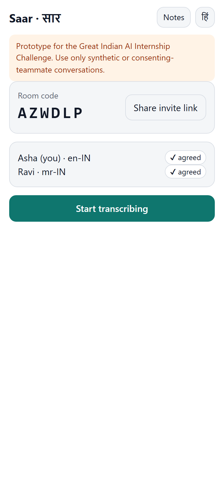
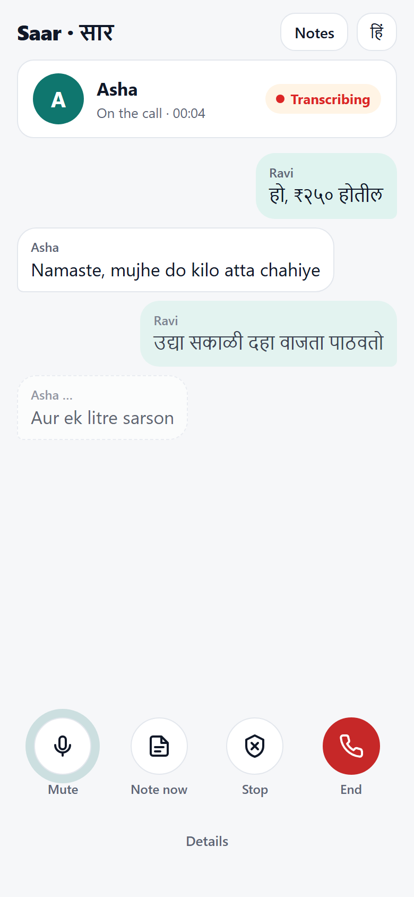
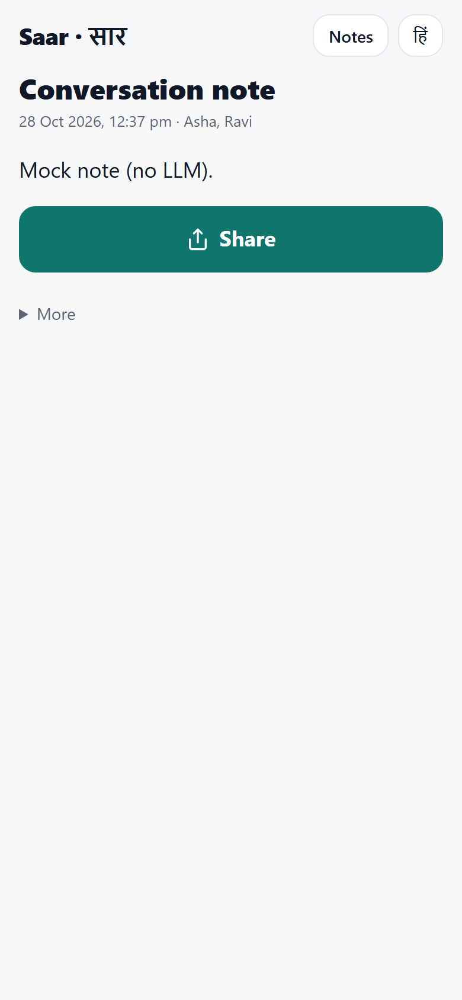

# Saar · सार — consent-first notes from a live call

**Two people, two phones, one app-to-app call. Each phone transcribes only its own voice — after both agree — and both get a faithful, structured note.** Built on Gnani Prisma realtime speech-to-text; handles Hinglish and Marathi in the same call.

| Lobby + consent | Live captions (two languages) | Note with evidence |
|---|---|---|
|  |  |  |

_Screenshots are from the automated two-phone test (fake mic, fake speech service, mock summariser)._

## What it does
1. The host starts a conversation and shares a 6-character code or link; the guest joins on their own phone (max 2).
2. Both read a versioned consent notice (English / हिन्दी) and tap **I agree**. The server — not the client — refuses capture until both have agreed.
3. An audio-only WebRTC call connects (LiveKit). Each phone sends **only its own microphone** to Saar, which proxies it to Gnani. Captions appear on both phones, labelled by speaker, in order.
4. **Quick note** any time, or **End** → an LLM writes a structured note (summary, key points, decisions, action items, entities, open questions, uncertain spans). Every point cites transcript line numbers; a deterministic **faithfulness check** flags any number or name not found in the transcript (⚠).
5. Notes are saved **on each phone** (IndexedDB, works offline), exportable as Markdown. The server copy is deleted after 24 h, or immediately on request.
6. Either person can **revoke** at any time: transcription stops for both within a second. A recording indicator is always visible while capture is on.

## Gnani models / APIs used — and where
| Gnani API | Used for | Code |
|---|---|---|
| **Prisma v2.5 realtime STT** (`wss://api.vachana.ai/stt/v3/stream`) | Every live caption. One upstream socket per participant, VAD tuned for conversation (threshold 0.5, 700 ms silence), ITN on (`x-format: transcribe`), optional word boosting, rotation before the 15-min session cap | `backend/app/gnani/stt_client.py`, `backend/app/ws/stt_proxy.py` |
| **Prisma STT REST** (`POST /stt/v3`) | Evaluation sweeps (faster than real-time) | `eval/run_eval.py` |
| **Timbre v2.5 TTS** (`POST /api/v1/tts/inference`) | Generating the synthetic evaluation dialogues | `eval/make_audio.py` |

**Non-Gnani components, stated plainly:** note writing uses **DeepSeek** (OpenAI-compatible API, transcript text only); the voice call is relayed by **LiveKit** (WebRTC). Gnani's Evon LLM is not used (not on the API platform).

## Architecture
```
 Phone A (PWA)                                         Phone B (PWA)
 LiveKit client  ◄──────── WebRTC call audio ────────►  LiveKit client
 Mic → AudioWorklet (16 kHz, 1,024-byte PCM frames)     Mic → AudioWorklet
   │ WS /ws/stt (own mic only)   WS /ws/room (events)     │
   ▼                                                      ▼
 ┌────────────────────── Saar backend (FastAPI, 1 process) ──────────────────────┐
 │ Rooms + consent state machine · STT proxy (pacer, rotation, reconnect)        │
 │ Room hub (reorder buffer, echo dedupe) · Summariser + faithfulness · Retention │
 │ SQLite (text only, 24 h)                                                      │
 └──────────────┬───────────────────────────────────────────────┬────────────────┘
                ▼                                               ▼
        Gnani Prisma STT (WebSocket)                    DeepSeek (note JSON)
```
Why per-phone transcription: perfect speaker separation without diarization, clean (not network-degraded) audio into ASR, and unambiguous consent — each person only ever streams their own voice. Details: [docs/ARCHITECTURE.md](docs/ARCHITECTURE.md).

## Quick start (local)
Prereqs: Python 3.11+, Node 20+.
```bash
cp .env.example .env        # then fill GNANI_API_KEY, OPENAI_COMPAT_API_KEY (DeepSeek), LIVEKIT_*
cd backend && python -m venv .venv && .venv/bin/pip install -e ".[dev,eval]"
cd ../frontend && npm ci && npm run build      # builds into backend/app/static
cd ../backend && .venv/bin/uvicorn app.main:app --port 8000
```
Phones need HTTPS for the microphone: `cloudflared tunnel --url http://localhost:8000` and open the printed URL on both phones. Without LiveKit keys the app still works (captions + notes), just without in-app call audio. **Solo test** mode needs one phone and no LiveKit.

Offline (no keys): run `python backend/scripts/fake_gnani_server.py --port 9001`, set `GNANI_WS_URL_OVERRIDE=ws://127.0.0.1:9001/stt/v3/stream` and `LLM_PROVIDER=mock`.

## Docker
```bash
docker compose up --build        # one container, one origin: http://localhost:8000
```

## Environment variables
| Variable | Default | Meaning |
|---|---|---|
| `GNANI_API_KEY` | — | Gnani key (server only; never sent to the browser) |
| `OPENAI_COMPAT_BASE_URL` / `OPENAI_COMPAT_API_KEY` / `LLM_MODEL` | `https://api.deepseek.com` / — / `deepseek-chat` | Note-writing LLM |
| `LLM_PROVIDER` | `openai_compat` | `openai_compat` or `mock` |
| `LIVEKIT_URL` / `LIVEKIT_API_KEY` / `LIVEKIT_API_SECRET` | — | Call audio; leave empty to disable the call |
| `CALL_AUDIO_PROVIDER` | `livekit` | `livekit` or `none` |
| `STT_VAD_THRESHOLD` / `STT_MIN_SILENCE_MS` / `STT_MIN_SPEECH_MS` / `STT_MIN_SEGMENT_MS` / `STT_MAX_SPEECH_S` | 0.5 / 700 / 100 / 120 / off | Gnani VAD headers |
| `STT_FORMAT_DEFAULT` | `transcribe` | ITN on (verbatim is used automatically with word boosting) |
| `MAX_STT_SECONDS_PER_ROOM` | 1800 | Credit guard: capture stops with a clear message |
| `SERVER_RETENTION_HOURS` | 24 | Server text retention |
| `DEMO_MODE` | true | Shows the "synthetic data only" banner |
| `ECHO_DEDUPE`, `MIC_AEC`, `MIC_NS`, `MIC_AGC` | true | Echo heuristic; browser mic processing |
| `JWT_SECRET`, `RATE_LIMIT_PER_MIN`, `LOG_LEVEL`, `LOG_TRANSCRIPTS` | | Security / logging (transcripts are never logged at INFO) |

Full list: [.env.example](.env.example).

## Tests
```bash
cd backend && .venv/bin/pytest                 # 31 tests: unit + real-WebSocket integration vs a protocol-faithful fake Gnani
cd frontend && npm test                        # resampler anti-aliasing, 1,024-byte framing, notes DB, Markdown, i18n
cd frontend && npm run build && npx playwright test   # two browser "phones" with fake mics, end to end
```

## Evaluation
`eval/` measures how Prisma + this pipeline behave under telephony-style degradation and how errors propagate into notes (WER/CER vs SNR, VAD presets, fact recall, hallucination rate, flag precision/recall). See [eval/README.md](eval/README.md) and the generated [eval/results/report.md](eval/results/report.md).

## Consent and privacy (summary)
- Capture only after **every** participant consents to the current notice version; revocable by either person at any time; always-visible indicator.
- **No audio at rest**: audio lives only in a ~3 s in-memory send queue. Only text is stored: on the server for 24 h (or deleted on demand), on each phone until the user deletes it.
- Third parties: Gnani (audio, for transcription), DeepSeek (transcript text, for the note), LiveKit (call audio relay).
- No PSTN/SIP, no phone-line tapping, no accounts, no phone numbers. Display names are free text.
- This is a prototype, **not legal advice**. Commercial deployment in India would require a compliance review against the Digital Personal Data Protection Act, 2023 and Rules, and applicable sector rules. Details: [docs/CONSENT_AND_PRIVACY.md](docs/CONSENT_AND_PRIVACY.md).

## Limitations
- App-to-app VoIP call, **not** phone-network calls.
- Captions arrive per utterance (after a ~0.7 s pause), not word by word.
- Phone browsers may suspend the mic in the background; Saar pauses and asks you to keep it open.
- Loudspeaker echo can duplicate captions; earphones are recommended (an echo heuristic hides likely duplicates).
- The evaluation uses synthetic TTS audio and simulated noise; small n.
- Notes can still contain errors; flags reduce but do not eliminate them.
- Single-instance prototype (in-memory hub; scaling out would need Redis pub/sub).
- The consent flow is a prototype, not a compliance certification.

More: [docs/LIMITATIONS.md](docs/LIMITATIONS.md).

## Team
| Member | Contribution |
|---|---|
| ⟦Member 1 — GitHub / LinkedIn⟧ | ⟦tasks⟧ |
| ⟦Member 2 — GitHub / LinkedIn⟧ | ⟦tasks⟧ |

## License
MIT.

## Acknowledgements
Gnani.ai for the Prisma and Timbre APIs and the Great Indian AI Internship Challenge.

#GnaniAI #GreatIndianAIInternshipChallenge
